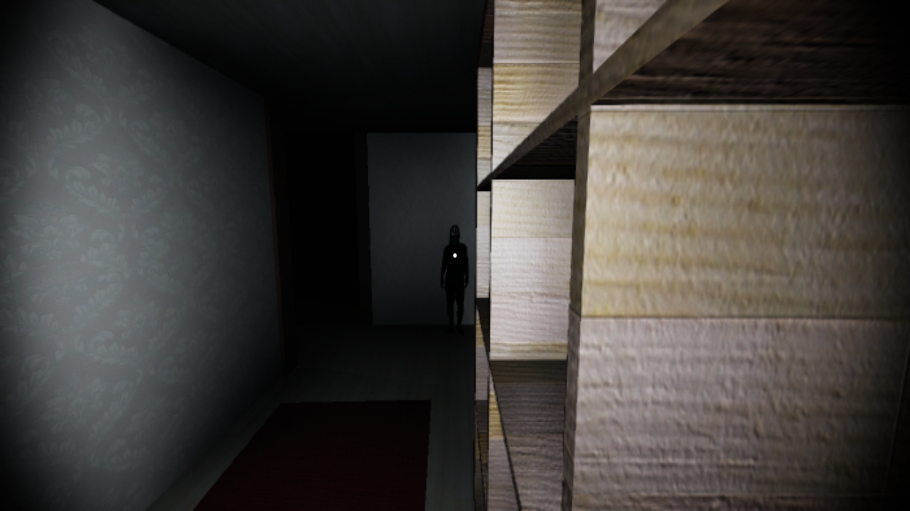

# The Mask Within

It's midnight. Someone is inside your house. Find a way into the attic and get out before they find you.

A small Windows survival-horror game by **Deep Datta Chaudhury**, originally made for a school fair in Unity.

**[Download v1.2 for Windows](https://github.com/deepgotnochill-cmd/the-mask-within/releases/download/v1.2.0/The.Mask.Within.Windows.zip)**

Extract the entire ZIP and run **The Mask Within.exe**. Keep the Data folder and other files beside it. Headphones help you locate footsteps and sounds around the house.



## The atmosphere update

Version 1.2 returns to the original house, menus, and escape sequence, with a clearer image and more unease between encounters.

- Removed motion blur, depth-of-field blur, grain, colour fringing, and lens distortion. Reduced bloom and cooled the colours so shapes stay readable in the dark.
- Added footsteps that continue after you stop, knocks behind you, slow light dips, brief masked-figure sightings, and a heartbeat during pursuit. The extra encounters wait while the hunter is close.
- Fixed the exit recognising a carried key, interaction zones losing the player too early, overlapping crank animations, and the hunter staying stopped after an attack.
- Pausing now pauses audio, and the door-opening sound survives the door disappearing.

The [original school-fair edition](https://github.com/deepgotnochill-cmd/the-mask-within/releases/tag/v1.0.0) remains available. The experimental v1.1 interface is not used in this version.

## Controls

| Action | Control |
| --- | --- |
| Move | W A S D |
| Look | Mouse |
| Run | Left Shift |
| Crouch | Left Ctrl |
| Pick up / interact | E |
| Turn the crank | Hold E |
| Pause | Esc |

Check the front door, follow the escape clues, finish turning the crank, collect the key, and reach the attic exit. The exit opens when you approach carrying the key.

## About the project

This was one of my first attempts at making a complete game. I used Unity, C#, and AI-assisted development to work through the programming while shaping the concept, atmosphere, and escape route. It is still a small school project, and I am improving it as I learn.

## Source

`Gameplay/` contains the C# scripts. The build script combines them with the original release's Unity 2022.3.20f1 player, scenes, and assets. This is a gameplay-source update, not a complete editable Unity project.

With a .NET SDK installed, download the original ZIP and run:

```powershell
./scripts/Build-Windows.ps1 -BaseZip ./The.Mask.Within.zip -OutputDirectory ./build
```

The script verifies the original archive's SHA-256 before building. See [verification notes](TESTING.md) for tested paths and remaining limitations.
